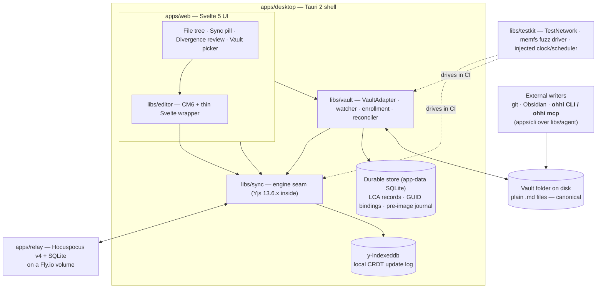

# Architecture overview — V1 tracer bullet

This is the system map for Editor's V1: a minimal collaborative markdown editor over a
test subfolder of the real vault, with CRDT sync between two Tauri clients and the collab
test harness green in CI. Ground truth is [plans/slices.md](../../plans/slices.md) (V1
section) and [plans/shaping.md](../../plans/shaping.md) (shape D); this doc is the
narrative map over those decisions.

The one-sentence model: **plain `.md` files on disk are canonical; CRDTs are the
transport and merge mechanism for files you chose to share; a reconciler keeps the two
honest with each other.**

## Component diagram

Two clients in the V1 demo run this whole stack each; they meet only at `apps/relay`
(and, out-of-band, at git — the dual-transport question is deferred to Spike S2).

## Packages and responsibilities

Rush monorepo, packages named `@ohhi/<name>`, created per-slice (shaping D10).
`rush.json`'s projects list is the source of truth for what exists.

| Package | Responsibility |
|---|---|
| `apps/desktop` | Tauri 2 shell. Hosts `apps/web`; provides native filesystem access (`watchImmediate`, atomic writes) so corruption bugs surface where they actually live (shaping D6). |
| `apps/web` | Svelte 5 UI: vault picker / first-run enroll, file tree (rendered from the folder doc's path→GUID map), sync pill, crude divergence review, binary badges. Since the shell foundations build (`plans/foundations-plan.md`) the shell renders from a **layout spec** read, with keymaps and templates, from ordered resource roots — the vault's `.ohhi/`, `~/.config/ohhi/` on desktop, built-in — and owns the generator for their schemas (`spec/ohhi.layout.v1` / `ohhi.keymap.v1`, `cd apps/web && rushx gen-schemas`). See [customising.md](../customising.md). |
| `libs/editor` | CodeMirror 6 editing surface in a thin Svelte wrapper; vendored y-codemirror.next binding; remote cursors via awareness. V1 is plain markdown, zero preview (shaping D3). |
| `libs/sync` | The **engine seam**. Owns Y.Docs, the Hocuspocus client provider per doc, reconnect/backoff, the `syncRecord` per doc, and heads/snapshot encoding. The only package that imports `yjs`. See [sync.md](sync.md). |
| `libs/vault` | The disk side: `TauriVaultAdapter` (read/write/list/rename + watcher), `enrollmentService` (GUID minting, seeding, binary detection), the `reconciler` (dmp ingest / materialize / diff3 escalation), `lcaStore`, `preImageJournal` + restore CLI. See [vault-and-reconciler.md](vault-and-reconciler.md). |
| `apps/relay` | Thin Hocuspocus v4 service on Fly.io: static-token auth against a relay-authoritative shares table, SQLite persistence. Deliberately dumb in V1. See [relay.md](relay.md). |
| `libs/workspace` | Host-neutral orchestration: a workspace is a set of **mounts** (a subtree bound to a room). Owns the folder map, doc lifecycle, carve/join/unshare, the mass-change breaker, the boot delta scan, the one event log (`AppEvent` / `EventLog`, each room's persisted `RoomEventLog` at `<room>/events.json`), arrival attribution of remote edits, the one room → relay resolver (`roomRelayUrl`), and the `SharedSnapshot` the Shared view renders. Knows nothing about Svelte — `apps/web` mirrors its events into runes. Extracted in M1. |
| `libs/ui` | Design tokens and themes (Tailwind v4 + DaisyUI v5). CSS + token-name types only — no components, no logic. Three bands driven by `data-theme`: DaisyUI chrome, `--ed-*` editor tokens, and unlayered `--ed-sync-*` honesty tokens. See [theming.md](../theming.md). |
| `libs/index` | The vault's **derived** index: full text, links, tags, headings, frontmatter keys. Droppable by construction, never a system of record. One swap-proof query interface over an in-memory backend; SQLite/FTS5 sits behind a measured trigger (`plans/v2-shaping.md` Fork 1). |
| `libs/frontmatter` | The note's leading `---` block. `parseFrontmatter` reads positions, scalar typing, tags (every Obsidian form, including the vault's legacy `[a b]`) and aliases; `patchFrontmatter` writes ONE line-range per op, so no untouched byte is re-emitted (golden rule 2). Flat subset only — nesting, multi-line scalars, anchors and duplicate keys are refused, never repaired. The single frontmatter writer for the index, the editor's tag strip and the CLI's `fm set` (read-shaping.md B4, Fork 4). |
| `libs/editor-lang` | Markdown language extras for CM6 — the `[[wikilink]]` `MarkdownConfig` on upstream `@codemirror/lang-markdown`, its decorations, click-through and completion. Live-preview decorations land here too. |
| `libs/testkit` | Injected clock/scheduler + lint rule, TestNetwork (seeded PRNG, partition/heal), memfs fuzz driver with crash injection, `fuzz-crashers/` corpus, git-audit script. See [testing.md](testing.md). |
| `libs/agent` | The **agent surface's command core** (G1): `VaultBackend` over `@ohhi/vault`'s Node adapter + `libs/index` + a CLI-owned pre-image journal, and the 17 ops — `ls`, `read`, `search`, `links`, `backlinks`, `unresolved`, `tags`, `resolve`, `stats`, `changes`, `write`, `patch`, `append`, `fm`, `mv`, `rm`, `restore` — declared once in `src/contract.ts`. Host-neutral: no process, no terminal, no transport. See [agent-access.md](../agent-access.md). |
| `apps/cli` | The **`ohhi`** binary: `run(argv, io) => exit code`, text for humans and `--json` for machines, plus `ohhi mcp` (a stdio MCP server) and `gen-schemas` (writes the op schemas in `spec/`; the two resource schemas there are `apps/web`'s). esbuild-bundled so a cold invocation beats ~500 ms. A thin adapter over `libs/agent` — it holds no vocabulary of its own. |

Split-on-demand later: `apps/agentd` (V3). Don't reference it before its slice
creates it. `libs/agent` arrived early, with the agent surface (G1), for the
purpose D10 reserved it for.

## Dependency rules

These are boundaries, not suggestions — the engine seam and the vault's independence
from the UI are what make the Yjs-v14/Loro hedge (shaping D1) and the headless test
harness possible.

1. **`apps/web` depends on `libs/*`**, never the reverse. Libraries don't know the UI exists.
2. **`libs/editor` depends on `libs/sync`** for doc handles and awareness — the editor
   binds to a doc session, it doesn't own sync state.
3. **Nothing outside `libs/sync` imports `yjs`.** All other packages speak the seam's
   vocabulary: opaque doc handles, encoded updates, heads (state vector + delete-set
   digest), origin tags. This is what keeps a future engine migration a one-package
   problem. *Enforcement note (assumption, consistent with D1/D3): the vendored
   y-codemirror.next binding is engine-coupled by nature; it is wired through types
   re-exported by the seam and its directory is the single lint exemption.* See the
   [engine seam primer](../primers/04-engine-seam.md).
4. **`libs/vault` never imports `libs/editor`.** The reconciler must run headless —
   for closed files, in tests, and eventually under any future host. It talks to docs
   only through the seam.
5. All Editor-owned sync/reconciler code takes an **injected clock/scheduler**
   (lint-enforced; third-party provider internals exempt). Deterministic simulation is
   the foundation of the harness (shaping D9).
6. **`libs/ui` is tokens and CSS only.** It imports nothing from other `libs/*`;
   other packages may import its `./tokens` entry (token names and helpers),
   never its CSS. The CSS is applied once by the app shell — a library that
   imported it would inject a second copy of every theme.
7. **`libs/index` depends on nothing but `@ohhi/frontmatter`** (itself pure,
   Node-safe and DOM-free), because a second frontmatter reader would let the
   index and the editor disagree about a note's tags. For the same reason it
   takes that package's line-offset helpers (`lineStartsOf`, `lineIndexAt`)
   rather than repeating the search: a line number has to mean one line. It is otherwise a pure
   data structure over text handed to it: it never reads disk, never touches
   the engine, and is fed from exactly one place (the workspace's index
   sink) — an index with N writers drifts from the vault.
8. **`libs/agent` never imports `libs/sync` or `libs/workspace`.** The agent
   surface is *files-direct*: it reads the canonical files and writes them
   journaled + atomic, and the running app's reconciler is the only reconciler
   over the folder. A second CRDT peer or a second LCA store on the same disk is
   the configuration [shaping](../../plans/shaping.md)'s decision log killed, and
   `plans/agent-surface-shaping.md` Fork 1 buried again. `apps/cli` depends on
   `libs/agent` and adds flags, rendering and a transport — never an operation.

## The two file modes

Every file in an Editor-managed folder is in exactly one mode (shaping D2; see the
[CRDT primer](../primers/01-crdts-and-yjs.md) for why this distinction matters):

| Mode | What it means | CRDT involvement |
|---|---|---|
| **Tracked** | A file Editor knows about but that is not shared anywhere. | **None at all.** No Y.Doc, no LCA record, no sync state. Editing it is plain file editing. |
| **Enrolled** | A file in a shared folder (or individually shared). | **Always-on local Y.Doc**, from enrollment onward, whether or not anyone else is online and whether or not the file is open. |

There is deliberately **no dormant or lazy mode** in between. The shaping decision log
records why: every "file write + LCA bump while the Y.Doc sleeps" design was shown to be
a specified data-loss algorithm (offline work gets classified as already-merged and
overwritten), and session-scoped engagement makes the sync pill structurally dishonest.
Always-on means offline edits are real CRDT ops captured locally with no relay and no
coordination — reconnection is just an update exchange ([sync.md](sync.md)).

The cost of always-on is that disk and CRDT can each move independently — which is
exactly the problem the reconciler exists to solve
([vault-and-reconciler.md](vault-and-reconciler.md), and the
[LCA reconciliation primer](../primers/03-lca-reconciliation.md)).

Binary files are neither: detected at enrollment, excluded from CRDT sync entirely, and
badged "not synced" in the tree. The pill never claims them (shaping D2f).

## How the pieces wire together (V1)

From [plans/slices.md](../../plans/slices.md), Wiring, in dataflow order:

1. On opening a folder, `enrollmentService` walks it, mints a GUID per file into the
   **folder Y.Doc** (the path→GUID map), seeds each file's Y.Text exactly once (single-
   seeder rule for joiners), and writes an LCA record per file to `lcaStore`.
2. `TauriVaultAdapter` watch events (content-hash change detection, quiesce =
   double-read-same-hash) flow into the `reconciler`, which either ingests external
   changes into the Y.Doc as ops tagged origin `'disk'` (LCA advanced in the same
   transaction) or raises `diverged` on the `syncRecord`, opening the review affordance.
3. `syncProvider` connects every enrolled doc plus the folder doc to `apps/relay`.
   Remote updates apply to local Y.Docs; for **closed** files they materialize to disk
   through the pre-image journal and atomic temp-fsync-rename.
4. `docSession` binds CM6 to the open doc's Y.Text — always-on, works relay-down. The
   editor owns the file while open, with a debounced flush on idle/close.
5. The sync pill renders a pure `f(syncRecord)` — it can be wrong only if the record is.
6. `libs/testkit` drives the same reconciler and sync code under injected clocks in CI.

## Golden rules (summary)

The repo-level rules in `CLAUDE.md` compress shape D; the docs here expand them:
files are canonical (1 → vault doc); never reserialize what you didn't change (2 → vault
doc, byte fidelity); always-on CRDT / zero-CRDT tracked split (3 → above); the pill never
lies (4 → [sync.md](sync.md)); injected clocks (5) and tested-not-hoped collab
correctness (6 → [testing.md](testing.md)).

## Reading order

[vault-and-reconciler.md](vault-and-reconciler.md) →
[sync.md](sync.md) → [relay.md](relay.md) → [testing.md](testing.md).
Primers, written for exactly this audience:
[01-crdts-and-yjs](../primers/01-crdts-and-yjs.md) ·
[02-plain-text-crdt-over-markdown](../primers/02-plain-text-crdt-over-markdown.md) ·
[03-lca-reconciliation](../primers/03-lca-reconciliation.md) ·
[04-engine-seam](../primers/04-engine-seam.md) ·
[05-sync-and-relay](../primers/05-sync-and-relay.md).
