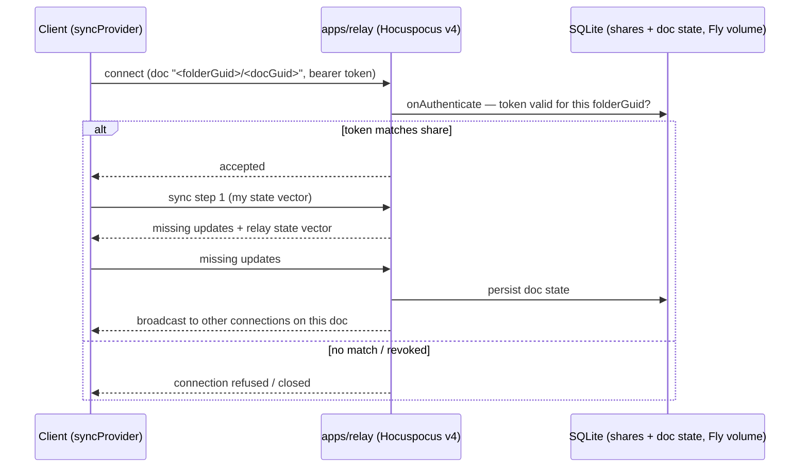

# Relay — apps/relay design (V1)

`apps/relay` is the rendezvous point: a deliberately thin **Hocuspocus v4** service that
authenticates connections, fans CRDT updates between clients, and persists doc state so
a single-device user still gets multi-device sync later. Self-hosted in spirit — one
cheap Fly.io VM, no third-party control plane (requirement R2.1). Ground truth: shaping
**D4** (and D4a for what is *not* in V1); the slices V1 `apps/relay` affordance.
Background: the [sync-and-relay primer](../primers/05-sync-and-relay.md).

The guiding posture: **the relay is infrastructure, not authority over content.** Files
on disk are canonical; the relay holds doc state so peers can converge, and it must
always be rebuildable/replaceable without being the only copy of anything (golden
rule 1). The one thing it *is* authoritative for: who may access which share.

## Service shape

- **Hocuspocus v4**, stock server with a small configuration surface: `onAuthenticate`
  for token checks, stock SQLite persistence (V1 explicitly uses stock persistence —
  slices: "D4 (static-token auth, stock persistence)").
- **Doc naming: `<folderGuid>/<docGuid>`.** Every Hocuspocus doc name carries its
  folder scope, so authorization is a prefix check: a connection authenticated for a
  share may only open docs under that share's folder GUID. The folder doc itself is
  just another doc under the same prefix.
- **Folder-GUID scoping is enforced relay-side**, from the shares table — never from
  doc contents. The folder Y.Doc's path→GUID map is advisory metadata for clients (file
  tree rendering, rename propagation); treating client-writable CRDT state as an auth
  source was shape C's privilege-escalation bug, and D4 exists to kill it.

## Auth and the share lifecycle

V1 auth = **static per-share bearer tokens** checked in `onAuthenticate` against the
**relay-authoritative shares table** in SQLite (assumed minimal columns: share id,
folder GUID, token hash, created/revoked — anything richer waits for a need):

1. **Create share** — the sharing device calls an authenticated relay CLI/API (the only
   mutation path; nothing in the CRDT plane can touch the table): registers the folder
   GUID, gets back a token.
2. **Token → joiner** — handed out out-of-band (V1: paste it). The joiner's provider
   presents it; `onAuthenticate` scopes the connection to that folder GUID.
3. **Joiner seeds nothing** — first connection pulls relay state into a clean/identical
   folder under the single-seeder rule
   ([vault-and-reconciler.md](vault-and-reconciler.md), Enrollment; the full join state
   machine is Spike S1).
4. **Revocation/change closes live connections** (D4) — a removed share doesn't linger
   as an open socket. Per-note shares get a minimal metadata side-channel (name only),
   not the whole folder map.

This *is* a control plane — kept tiny and honest rather than pretended away (shaping
decision log, Sharing/auth).

## What the relay can and cannot read

**Today: plaintext.** The relay applies Yjs updates to server-side doc state in order to
persist and serve them, so a relay operator can read note content. Acceptable for V1
because the operator is us, on our own Fly app, for a test subfolder.

**Later: Keyhive-compatible seams, kept deliberately open** (R8 watch track):

- **Payload-opaque sync path** — nothing in our design requires the relay to interpret
  update payloads; persistence-as-blobs keeps an E2EE future possible.
- **Device-key principals** — V1's static tokens give way to Ed25519 device keys at
  team onboarding (D4), with users modeled as device groups — the same shape Keyhive
  capabilities would attach to.
- **Pluggable auth** — `onAuthenticate` stays the single seam where token checks become
  capability checks.

No E2EE work happens now; the re-evaluation trigger is the public debut or a security
audit ([slices.md](../../plans/slices.md), Later).

## Persistence and deployment

- **SQLite on a Fly.io volume**: doc state (stock Hocuspocus persistence) and the
  shares table. One small shared-CPU VM, one volume — the cheap-VPS spirit of R2.1.
- **Litestream plan**: continuous SQLite replication to object storage is the D4
  standard; slices schedules *continuous* litestream alongside the V2 update-log work.
  V1 may run with volume snapshots only — acceptable precisely because the relay is
  never the sole copy: every enrolled doc's state lives in full on each client, and the
  files live on disk. Relay loss in V1 means re-seeding coordination (single-seeder
  rule; automated epoch fencing is Spike S1), not data loss.
- **Fly.io shape**: single region, single instance, volume-pinned. No horizontal
  scaling story in V1 and none needed — connection counts are two clients over a test
  subfolder. The 5k-doc / reconnect-storm question is measured by Spike S5 before
  full-vault migration, not guessed at now.
- Kill-9/restore of the relay is a standing L1 scenario, and "kill the relay" is in the
  V1 demo script — resilience here is tested behavior, not an ops aspiration
  ([testing.md](testing.md)).

## Explicit non-goals for V1

Each of these is deferred with a pointer, not forgotten:

| Non-goal | Why deferred | Pointer |
|---|---|---|
| **Update log** (append-on-message hook, snapshot+truncate compaction) | Honestly custom code; lands V2 before dogfood history accumulates. V1 keeps stock doc-state persistence. | shaping D4a |
| **Per-device acked heads / durable-ack green** | y-protocol has no per-update acks; the wire-level extension is undesigned. V1 pill keys green off provider-synced and says so ([sync.md](sync.md)). | shaping D11, Spike S4 |
| **Device-key (Ed25519) auth** | Static per-share tokens suffice for a two-client tracer; device principals arrive at team onboarding. | shaping D4 |
| **Folder-level head summary** ("is anything stale?" without 5k sessions) | Scale problem V1 doesn't have. | shaping D4a, Spike S5 |
| **Attachment/blob sync** | Binaries are excluded + badged in V1; CAS LWW blobs in V2. | shaping D2f |
| **Relay-side agents** | Trigger: first need for agents in sessions with no desktop peer. | slices Later |

The discipline matters: every line of relay code is code a future engine migration,
auth upgrade, or E2EE pivot has to carry. V1's relay should stay boring.

## See also

- [sync.md](sync.md) — the client half: providers, reconnect, syncRecord.
- [overview.md](overview.md) — where the relay sits in the system map.
- [testing.md](testing.md) — relay kill/restore scenarios; the L2 smoke runs against a
  real relay instance.
- Primers: [05-sync-and-relay](../primers/05-sync-and-relay.md),
  [01-crdts-and-yjs](../primers/01-crdts-and-yjs.md).
- Plans: [shaping.md](../../plans/shaping.md) D4/D4a, Spikes S1/S4/S5, decision log
  (Sync server, Sharing/auth); [slices.md](../../plans/slices.md) V1 wiring, V2 scope.
