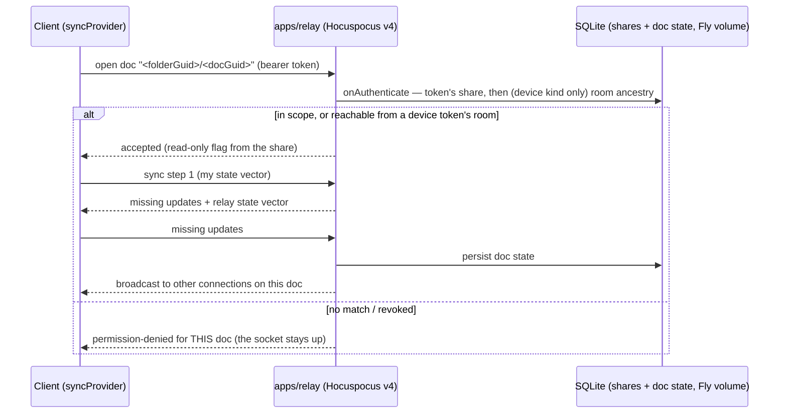

# Relay — apps/relay design (V1)

`apps/relay` is the rendezvous point: a deliberately thin **Hocuspocus v4** service that
authenticates connections, fans CRDT updates between clients, and persists doc state so
a single-device user still gets multi-device sync later. Self-hosted in spirit — one
cheap Fly.io VM, no third-party control plane (requirement R2.1). Ground truth: shaping
**D4** (and D4a for what is *not* in V1); the slices V1 `apps/relay` affordance.
Background: the [sync-and-relay primer](../primers/05-sync-and-relay.md).

The guiding posture: **the relay is infrastructure, not authority over content.** Files
on disk are canonical; the relay holds doc state so peers can converge, and it must
always be rebuildable/replaceable without being the only copy of anything (golden
rule 1). The one thing it *is* authoritative for: who may access which share.

## Service shape

- **Hocuspocus v4**, stock server with a small configuration surface: `onAuthenticate`
  for token checks, stock SQLite persistence (V1 explicitly uses stock persistence —
  slices: "D4 (static-token auth, stock persistence)").
- **Doc naming: `<folderGuid>/<docGuid>`.** Every Hocuspocus doc name carries its
  folder scope, so authorization starts as a prefix check: a connection authenticated
  for a share may open docs under that share's folder GUID. The folder doc
  (`<folderGuid>/folder`) is just another doc under the same prefix. A *device* token
  reaches one step further — see [Auth](#auth-and-the-share-lifecycle).
- **Folder-GUID scoping is enforced relay-side**, from the shares table — never from
  doc contents. The folder Y.Doc's path→GUID map is advisory metadata for clients (file
  tree rendering, rename propagation, and since N1 the `kind:'mount'` entry that says
  a subtree moved to its own room); treating client-writable CRDT state as an auth
  source was shape C's privilege-escalation bug, and D4 exists to kill it.

## Auth and the share lifecycle

Auth = **static per-share bearer tokens** checked in `onAuthenticate` against the
**relay-authoritative shares table** in SQLite. Two tables carry it (`db.ts`):

- **`shares`** — `{ token, folder_guid, read_only, label, created_at, kind }`. `kind`
  arrived with device linking (N1/N3, device-link-shaping **A4-A**) and is the only
  thing that decides how far a token reaches:
  - **`folder`** (the default, and what every token minted before N3 reads as): exact
    room. A folder token never reaches the vault the folder was carved out of, nor a
    sibling carve of that vault. This is requirement **R5**, and it is enforced here
    rather than trusted to a client.
  - **`device`** — one person's own devices. It reaches its own room *and* any room
    whose recorded ancestry leads back to it, so a folder carved **after** the devices
    were linked needs no new paste.
- **`rooms`** — `{ child_guid PRIMARY KEY, parent_guid }`: which room was carved out of
  which. Written by the mint (below), never by anything in the CRDT plane.

**The rule, exactly** (`server.ts`, `onAuthenticate`), for doc name `<room>/<docGuid>`:

1. Look the token up. Unknown ⇒ refused.
2. **Prefix check**: `documentName` starts with `<share.folder_guid>/` ⇒ accepted. The
   folder doc (`<share.folder_guid>/folder`) is one of those names, not a special case.
3. Otherwise, **only when `share.kind === 'device'`**: walk `ancestorsOf(<room>)` — the
   `rooms` chain, nearest parent first — and accept if it contains the token's room.
   The walk is bounded at `MAX_ANCESTRY_HOPS = 8` and cycle-guarded, so a corrupt or
   malicious edge set costs a fixed number of indexed lookups per authentication.
   Depth 1 is all the product creates today (only the root mount may contain mounts);
   the 8 is headroom for any-depth nesting, which is Later.
4. Otherwise refused. Never the reverse direction: a child's token never reaches its
   parent, so a folder share's scope (**R1**) is unchanged by any of this.
5. `read_only` is **orthogonal**: it flips `connectionConfig.readOnly` on whatever the
   rule accepted, so a read-only *device* token is read-only in **every** room it
   reaches, including rooms carved after it was minted. There is no way to express
   "read-write in my vault, read-only in `team/`" — a known limit, recorded rather than
   discovered later.

**Ancestry is structure, not a credential.** A row in `rooms` grants nothing; only
`shares` grants access. Recording that `team/` was carved out of a vault is safe even
when nobody holds a device token for that vault, which is why the carve path records the
edge **always** rather than only for relay-attached roots.

**The mint** (`admin.ts`, guarded by `Authorization: Bearer <OPERATOR_SECRET>`; with no
secret configured the `/shares` routes answer 404 and the CLI is the only mutation
path):
`POST /shares { folderGuid, label?, readOnly?, kind?: 'folder'|'device', parent? }`
→ `{ token, folderGuid, readOnly, label, kind, parent? }`. Validation: `kind` must be
one of the two; `parent` must be non-empty when present and must differ from
`folderGuid`; **`parent` together with `kind:'device'` is refused** — a device token is
minted for a root room, never for a child. The ancestry edge is written *after* a
successful mint, so a failed mint leaves no edge behind.

**An ancestry edge is write-once.** Re-minting a room with the *same* parent is
idempotent and answers 200 as it always has; re-minting it under a *different* parent
answers **409** and mints nothing (`ON CONFLICT(child_guid) DO NOTHING` in `db.ts` is the
same rule stated where it cannot be bypassed). This is not hypothetical tidiness: the
operator secret is relay-wide (below), so on a relay serving more than one vault a silent
re-point would move a victim's room under the caller's vault, and every device token for
that vault would reach it through step 3.

**The operator secret authorises a relay, not a vault.** `OPERATOR_SECRET` is one
process-wide credential: whoever holds it can mint, list and revoke shares for *any* room
on that relay, including rooms belonging to vaults they have never seen. It is an
operator credential for a small team running its own relay — not per-user authorisation,
and not a boundary between the vaults on one relay. The successor is D4's device-key
principals, where a mint is authorised by the key that owns the room; until then, "one
relay per trust boundary" is the deployment rule, and the write-once ancestry edge above
is what keeps a shared relay from re-parenting rooms behind a vault's back.

**Migration is additive.** `CREATE TABLE IF NOT EXISTS rooms` adds the table;
`migrate()` `ALTER TABLE`s `kind` onto a `shares` written before it existed; a NULL
`kind` reads as `'folder'`, so an old dogfood token keeps exact-match semantics and
never silently becomes a device credential. Rooms carved **before** N3 have no ancestry
edge and stay unreachable by a device token until someone re-mints them with a `parent`
— not worth a backfill, because the link bundle (A4-B) and paste-once (A4-C) already
cover every pre-existing room.

The lifecycle around it is unchanged:

1. **Create share** — the sharing device calls the authenticated admin API or the relay
   CLI (the only mutation paths; nothing in the CRDT plane can touch the table):
   registers the folder GUID (plus `kind`/`parent`), gets back a token.
2. **Token → joiner** — handed out out-of-band (paste a share link: `editor1:` +
   base64url of `{relay, room, token}`, optionally a `label` and the sharer's
   self-reported `from`, bare or as `https://<host>/join#editor1:…` with the
   payload in the fragment, `apps/web/src/lib/share-link.ts`). The joiner's
   provider presents it per document; the rule above scopes what it can open. Tokens
   never travel in a folder map or a mount desc (shaping **D4**): they live in the
   pasting device's own config.
3. **Joiner seeds nothing** — first connection pulls relay state into a clean/identical
   folder under the single-seeder rule
   ([vault-and-reconciler.md](vault-and-reconciler.md), Enrollment; the full join state
   machine is Spike S1).
4. **Revocation blocks the NEXT connection, not the live one.** `DELETE /shares/<token>`
   removes the share row, so every subsequent `onAuthenticate` for that token is
   refused; connections that are already open keep syncing until they reconnect. That is
   dogfood **R4.3**, still deferred, and it is pinned by a test rather than assumed
   (`libs/workspace/test/device-link-auth.test.ts`). Revocation also does **not** delete
   the room's ancestry edge — the edge is structure, and it grants nothing on its own;
   a re-mint for the same room therefore needs no re-parenting.

This *is* a control plane — kept tiny and honest rather than pretended away (shaping
decision log, Sharing/auth).

### The connection model: one socket per room, auth per document

A mount opens **one** WebSocket for its room and rides every document of that room on
it (`libs/workspace/src/providers.ts`; the measurement that forced it is spike S10-Q4 —
a socket per doc put a 1,029-note vault on 1,030 concurrent sockets, over the browser's
~200-255 global cap). Hocuspocus v4 multiplexes by document name, and the server runs
`onAuthenticate` **per document**, not per connection: a rejection is answered with a
`permission-denied` addressed to that document only, leaving the socket and every other
document on it untouched (verified against `@hocuspocus/server` 4.1.2 and exercised
against the real relay in `libs/workspace/test/providers.test.ts`).

Two consequences worth stating:

- A **device** token is checked once per document it opens, so the ancestry walk runs on
  every doc of every carved room — hence the bound and the index on `rooms(child_guid)`.
- A refusal is **permanent, not a reconnect loop**: the client surfaces it through
  `reportAuthFailure` as a stated error ("the relay rejected this token"), and a mount
  that has no credential at all is not connected at all — it runs provider-less in the
  `needs-token` state rather than pretending to be offline (spike S10 Q2, golden
  rule 4).

## What the relay can and cannot read

**Today: plaintext.** The relay applies Yjs updates to server-side doc state in order to
persist and serve them, so a relay operator can read note content. Acceptable for V1
because the operator is us, on our own Fly app, for a test subfolder.

**Later: Keyhive-compatible seams, kept deliberately open** (R8 watch track):

- **Payload-opaque sync path** — nothing in our design requires the relay to interpret
  update payloads; persistence-as-blobs keeps an E2EE future possible.
- **Device-key principals** — V1's static tokens give way to Ed25519 device keys at
  team onboarding (D4), with users modeled as device groups — the same shape Keyhive
  capabilities would attach to.
- **Pluggable auth** — `onAuthenticate` stays the single seam where token checks become
  capability checks.

No E2EE work happens now; the re-evaluation trigger is the public debut or a security
audit ([slices.md](../../plans/slices.md), Later).

## Persistence and deployment

- **SQLite on a container volume**: doc state (stock Hocuspocus persistence), the
  shares table and room ancestry, in one file under `DATA_DIR` (`/data` in the image).
  One small container on a cheap host — the spirit of R2.1. Build/run/operate:
  [apps/relay/README.md](../../apps/relay/README.md).
- **Image**: `apps/relay/Dockerfile`, built from the repo root with dependencies pinned
  to the repo lockfile (its header says how). Non-root; node is PID 1 and turns
  `docker stop`'s SIGTERM into flush-then-exit. `OPERATOR_SECRET` is a runtime secret,
  never baked in; `SEED_SHARE` is dev/e2e only.
- **Host shape**: single instance, one volume, port bound to loopback behind the host's
  reverse proxy (Caddy), which terminates TLS and proxies the websocket. Unauthenticated
  `GET /healthz` answers 200 only while the database answers a read (503 otherwise) and
  drives the image's `HEALTHCHECK`. No horizontal scaling story in V1 and none needed —
  a small team over shared folders. The 5k-doc / reconnect-storm question is measured
  by Spike S5 before full-vault migration, not guessed at now.
- **Backups, then litestream**: `cli.ts backup <dest>` takes an online SQLite backup
  (safe while serving), run nightly from host cron via `docker exec` and pruned there.
  Continuous replication to object storage (litestream) stays the D4 standard,
  scheduled alongside the V2 update-log work. Nightly backups suffice until then
  precisely because the relay is never the sole copy: every enrolled doc's state lives
  in full on each client, and the files live on disk. Relay loss means re-creating
  shares and re-seeding coordination (single-seeder rule; automated epoch fencing is
  Spike S1), not data loss — a backup saves the re-creation.
- Kill-9/restore of the relay is a standing L1 scenario, and "kill the relay" is in the
  V1 demo script — resilience here is tested behavior, not an ops aspiration
  ([testing.md](testing.md)).

## Explicit non-goals for V1

Each of these is deferred with a pointer, not forgotten:

| Non-goal | Why deferred | Pointer |
|---|---|---|
| **Update log** (append-on-message hook, snapshot+truncate compaction) | Honestly custom code; lands V2 before dogfood history accumulates. V1 keeps stock doc-state persistence. | shaping D4a |
| **Per-device acked heads / durable-ack green** | y-protocol has no per-update acks; the wire-level extension is undesigned. V1 pill keys green off provider-synced and says so ([sync.md](sync.md)). | shaping D11, Spike S4 |
| **Device-key (Ed25519) auth** | Static per-share tokens suffice; device principals arrive at team onboarding. The `kind:'device'` token is the V1→V2 bridge — the first credential that means "a person's devices" rather than "a folder". | shaping D4, device-link-shaping A4-A |
| **Folder-level head summary** ("is anything stale?" without 5k sessions) | Scale problem V1 doesn't have. | shaping D4a, Spike S5 |
| **Attachment/blob sync** | Binaries are excluded + badged in V1; CAS LWW blobs in V2. | shaping D2f |
| **Relay-side agents** | Trigger: first need for agents in sessions with no desktop peer. | slices Later |

The discipline matters: every line of relay code is code a future engine migration,
auth upgrade, or E2EE pivot has to carry. V1's relay should stay boring.

## See also

- [sync.md](sync.md) — the client half: providers, reconnect, syncRecord.
- [overview.md](overview.md) — where the relay sits in the system map.
- [testing.md](testing.md) — relay kill/restore scenarios; the L2 smoke runs against a
  real relay instance.
- Primers: [05-sync-and-relay](../primers/05-sync-and-relay.md),
  [01-crdts-and-yjs](../primers/01-crdts-and-yjs.md).
- Plans: [shaping.md](../../plans/shaping.md) D4/D4a, Spikes S1/S4/S5, decision log
  (Sync server, Sharing/auth); [slices.md](../../plans/slices.md) V1 wiring, V2 scope;
  [device-link-shaping.md](../../plans/device-link-shaping.md) A4-A/R5 and
  [spike-s10-nested-mounts.md](../../plans/spike-s10-nested-mounts.md) Q3 for the share
  kinds, the ancestry contract and the token lookup order on the client.
