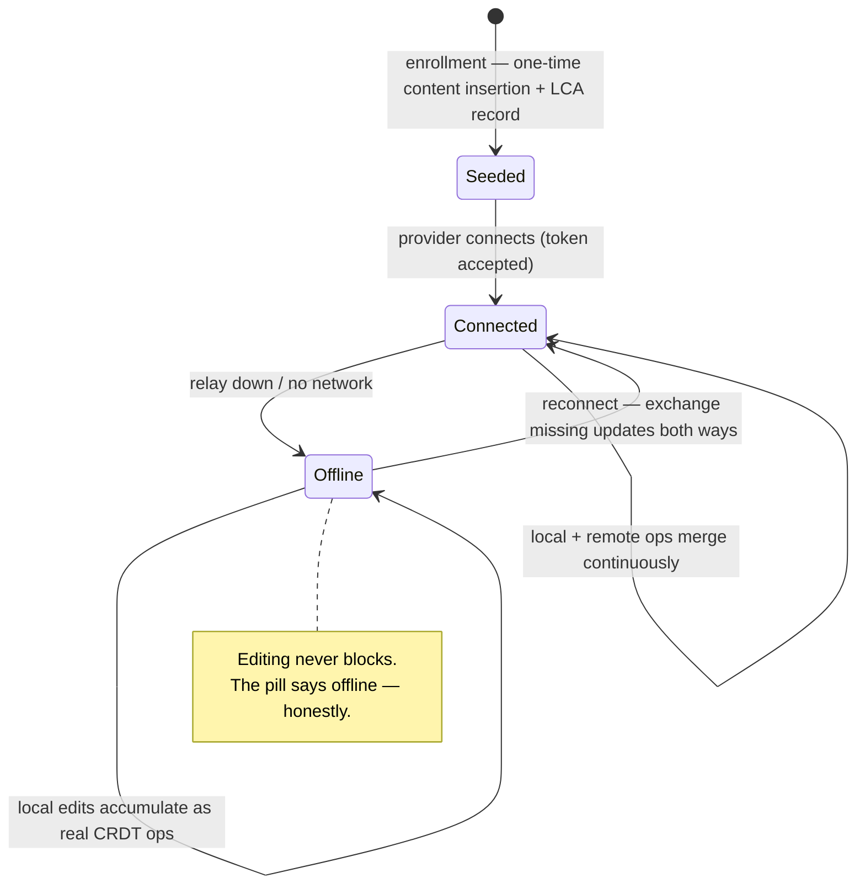

# Sync — enrolled-doc lifecycle and sync state

`libs/sync` owns everything CRDT: the Y.Docs for enrolled files, the folder doc, the
per-doc relay providers, heads encoding, and the `syncRecord` that the sync pill renders.
It is the **only** package that imports `yjs` — everyone else speaks the engine seam's
vocabulary (opaque doc handles, encoded updates, heads, origin tags). Ground truth:
shaping **D1, D2, D5, D11** and the V1 affordances in
`slices`. Background: primers
[01-crdts-and-yjs](../primers/01-crdts-and-yjs.md) and
[04-engine-seam](../primers/04-engine-seam.md).

## The doc topology

Per shared folder:

- **One Y.Doc per enrolled file**, holding the note text as a Y.Text. Always-on from
  enrollment: it exists and accumulates ops whether the file is open, closed, online,
  or offline (the tracked/enrolled split is covered in [overview.md](overview.md)).
- **One folder doc** per shared folder: the path→GUID map that the file tree renders
  and that carries create/rename/delete. It is advisory metadata — never an auth
  source (that decision kills a whole privilege-escalation class; see
  [relay.md](relay.md)).

Each doc gets its **own Hocuspocus provider connection**, doc-named
`<folderGuid>/<docGuid>` on the relay. V1 scope is a test subfolder (small N), so
per-doc sessions are fine; vault-scale currency without 5k sessions is explicitly
deferred (shaping D4a, Spike S5).

Local CRDT persistence in V1 is **y-indexeddb** (the doc's update log survives app
restarts without replaying from the relay). This has a hard exit trigger: migrate to the
durable doc store **before teammate onboarding** (shaping D5). The durable app-data
store already exists in V1 for LCA records and the pre-image journal — it is a different
store with different droppability rules
([vault-and-reconciler.md](vault-and-reconciler.md)).

## Lifecycle of an enrolled doc



- **Open file:** `docSession` binds CM6 to the doc's Y.Text via the vendored
  y-codemirror.next binding; awareness carries remote cursors/selections. The Y.Doc is
  the source of truth for content — editor state is a view, never mirrored into Svelte
  state. The editor owns the file while open; disk flushes are debounced on idle/close
  (MergeHSM-style invariant 3), going through the journaled atomic write path.
- **Closed file:** the doc keeps syncing. Remote advances materialize to disk through
  the reconciler's CRDT-advanced path
  ([vault-and-reconciler.md](vault-and-reconciler.md)).
- **External edit:** the reconciler ingests it as ops tagged origin `'disk'`; from the
  sync layer's perspective it is just another local transaction to propagate.

## Offline and reconnection

Offline is not a mode — it is the absence of a connection. Local edits keep landing in
the local Y.Doc as real, durable ops (y-indexeddb). On reconnect the provider runs the
standard update exchange: each side states what it has (its state vector), receives the
updates it is missing, and both converge. No merge UI, no conflict files — concurrent
edits to the same note merge at the CRDT layer (see the
[sync-and-relay primer](../primers/05-sync-and-relay.md) for the protocol walkthrough).

This is exactly the property the V1 demo kills the relay to prove: both clients keep
editing, pills go offline honestly, reconnect converges. The same scenario is asserted
deterministically at L0 (partition/heal on the TestNetwork) and in the L2 smoke
([testing.md](testing.md)).

## Heads: why a state vector alone is not enough

"Has this doc changed?" and "have these two replicas converged?" are answered by
comparing **heads = Yjs snapshot = state vector + delete set** (shaping D1), not the
state vector alone and never rendered text:

- A **state vector** counts inserted ops per client. A **delete-only** update changes
  visible content while leaving the state vector's coverage of insertions intact —
  comparing SVs alone misclassifies "you deleted a paragraph" as "nothing happened".
  So heads include a delete-set digest.
- Rendered-text comparison is even weaker: two replicas can show equal text while
  holding different histories that will diverge on the next concurrent edit. Hence the
  harness rule: **convergence is asserted on encoded state only** (D9).

The same snapshot type is what the LCA record stores to answer "did the CRDT move since
disk and CRDT last agreed?" — one definition of "position in history", used everywhere.

## syncRecord and the pill

Per-doc reactive record, owned by `libs/sync`, rendered by `apps/web` (shaping D11):

```
{ connected,        // provider has a live, authenticated relay connection
  pendingOps,       // local ops not yet accepted by the relay
  diskMatchesCrdt,  // disk content == CRDT content (flush/materialize settled)
  diverged }        // reconciler raised a true three-way conflict
```

The pill is a **pure function `f(syncRecord)`** — a plain exported function with no
component state, asserted exhaustively in unit tests and under partition in the
harness. The pill component renders the result and contains no further logic.

| Status | Meaning | Condition (V1) |
|---|---|---|
| **green** | Safe everywhere: your edits are durably at the relay, disk agrees with the CRDT, no conflict. | `connected && pendingOps == 0 && diskMatchesCrdt && !diverged` |
| **yellow** | Working, not settled: ops in flight to the relay, or a disk flush/materialization pending. Don't panic, don't power off. | `connected && (pendingOps > 0 \|\| !diskMatchesCrdt) && !diverged` |
| **red** | Divergence needs you: a true three-way conflict awaits hunk review. CRDT sync continues; disk is frozen for this file until resolved. | `diverged` (dominates everything) |
| **offline** | No relay: edits are safe locally and will exchange on reconnect — but nothing is reaching other devices. | `!connected && !diverged` |

**Honesty rule (golden rule 4): green must never lie.** The full standard is *durable*
relay ack — the relay has fsynced your ops, not merely received them. **V1
approximation, noted deliberately:** the y-protocol has no per-update acks, so V1's
`pendingOps == 0` keys off the provider's synced state (relay received and applied).
That is receipt, not durability. Closing the gap — ack-after-fsync ordering against the
relay update log, per-device acked heads — is shaping **D4a / Spike S4**, landing V2
(`durableAck` joins the record then). The rollup pill is the worst status across open
docs; binaries are excluded from sync and never claimed by any pill.

## What lives behind the seam

So that an engine migration (Yjs v14) or swap (Loro) stays a one-package problem, the
seam exports capabilities, not yjs types: create/load doc, apply/encode update,
subscribe, transact-with-origin, heads encode/compare, awareness, provider lifecycle.
Consumers (`libs/vault`, `libs/editor`, `apps/web`, `libs/testkit`) are lint-banned from
importing `yjs` directly ([overview.md](overview.md), dependency rule 3). The insurance
that the seam is real: L0/L1 invariants run against the seam surface, so a swapped
engine must pass the same harness (shaping D1).

## See also

- [relay.md](relay.md) — the other end of the provider connection; auth and persistence.
- [vault-and-reconciler.md](vault-and-reconciler.md) — how `diskMatchesCrdt` and
  `diverged` actually get set.
- [testing.md](testing.md) — L0 TestNetwork, pill-under-partition assertions.
- Primers: [05-sync-and-relay](../primers/05-sync-and-relay.md),
  [04-engine-seam](../primers/04-engine-seam.md),
  [01-crdts-and-yjs](../primers/01-crdts-and-yjs.md).
- Plans: `shaping` D1/D5/D11, Spikes S4/S5;
  `slices` V1 `syncProvider`/`syncRecord`/`docSession`.
