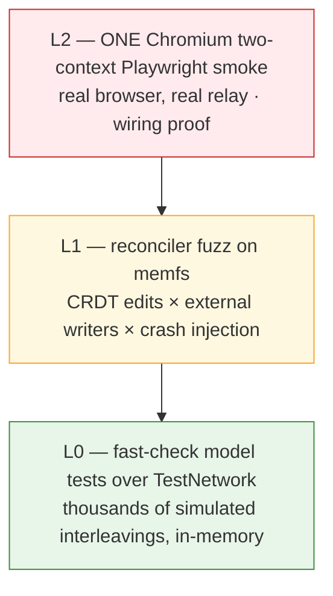

# Testing — the three-tier collab harness (V1)

Collab correctness is a tested property, not a hope (requirement R7, golden rule 6):
merge quality, convergence, and sync-state truthfulness are asserted from the first
commit, deterministically, in CI. The harness lives in `libs/testkit` and drives the
**same** production reconciler and sync code — not test doubles of them. Ground truth:
shaping **D9**, the slices V1 `testkit` affordance, and `.claude/skills/testing` (the
working conventions; this doc is the design rationale).

Push every scenario as far down the pyramid as it fits: L0 if the model can express it,
L1 if it needs a filesystem, L2 only if it needs a real browser.

## The precondition: injected clock/scheduler (lint-enforced)

All Editor-owned sync and reconciler code (`libs/sync`, `libs/vault`) takes an injected
clock/scheduler — no `Date.now()`, no `setTimeout`/`setInterval`, no ambient timers. A
lint rule enforces it; third-party internals (Hocuspocus, y-*) are exempt. This is what
makes L0/L1 deterministic: the harness owns time, so debounced flushes, quiesce windows,
reconnect backoff, and escalation thresholds run identically across thousands of
simulated interleavings — and a failing seed replays exactly. No sleeps, ever; tests
advance the injected clock and step delivery explicitly.

## L0 — model-based property tests (fast-check + TestNetwork)

Fast, fully in-memory, per-PR. fast-check model-based testing drives a **TestNetwork**
in `libs/testkit` — a port of the Yjs testHelper pattern: simulated clients exchanging
queued messages, with all randomness from a **seeded PRNG**.

- **Primitives:** `deliverOne` (deliver a single queued message — interleaving
  control), `deliverAll` (drain to quiescence), `partition` / heal (split clients into
  isolated groups and reconnect them — the offline/rejoin scenario as a one-liner).
- **Commands** model actions: insert, delete, open/close doc, go offline, rejoin. The
  property machinery composes random command sequences, exploring interleavings nobody
  thought to script. Adding a sync behavior means adding/extending a command, not
  writing a bespoke scenario test.
- **Convergence is asserted on encoded CRDT state** — heads = state vector +
  delete-set digest — never on rendered text. Delete-only updates change content
  without changing the state vector's insert coverage; text comparison hides divergent
  histories ([sync.md](sync.md), Heads).
- **Shrinking:** on failure, fast-check shrinks the command sequence to a **minimal
  failing edit script** — typically a handful of ops — and the **replay seed is printed**.
  Reproduce first (`fc.assert(model, { seed, path })`), then debug.

## L1 — reconciler fuzz on memfs

The reconciler is the highest-blast-radius code in the system
([vault-and-reconciler.md](vault-and-reconciler.md)), so it gets its own fuzz tier: an
in-memory filesystem (memfs) where the fuzzer interleaves **CRDT edits** with
**external-writer mutations** — git-shaped (branch switches, checkouts), Claude
Code-shaped (whole-file rewrites), Obsidian-shaped (frontmatter rewrites, stale-buffer
echoes) — plus **crash injection at write boundaries** (kill between temp-write, fsync,
and rename; relay kill-9/restore). The scenario matrix includes two-bridge
double-ingestion, delete-only updates, rename×rename, partial writes, stale-buffer
echo, two-device bootstrap, and mass-change.

**Blocking invariants — every run asserts all of them; any violation fails the PR:**

| Invariant | What it catches |
|---|---|
| **Convergence** across all replicas *and* disk | Split-brain, lost updates, LCA drift |
| **No data loss** — no writer's edit silently disappears | The dormant-mode class of bugs; bad escalation thresholds |
| **Byte-level EOL round-trip** — per-file EOL flavor/BOM preserved; untouched bytes stay untouched | Churn diffs, the R1.1 killers |
| **Valid frontmatter untouched** after every merge (and checkbox count/order preserved — the structural-invariant family, D9) | Merges that are textually fine but structurally corrupting |
| **Idempotence** — re-running the reconciler over a settled state changes nothing | Feedback loops: self-triggering watcher events, echo ingestion |

**`fuzz-crashers/` permanent corpus rule:** every counterexample the fuzzer ever finds
is shrunk and checked in as a named fixture (e.g. `0042-rename-x-rename.spec.ts`),
replayed on every CI run forever. Entries are never deleted — an "obsolete" crasher is a
design discussion, not a cleanup commit. A fix PR includes its shrunk counterexample as
the regression test.

## L2 — one Chromium two-context Playwright smoke

**Exactly one** two-context Chromium spec per PR: two browser contexts (two simulated
devices) against a **real relay**, proving the wiring end-to-end. Four scenarios in the
single spec:

1. **Edit propagation** — type in context A, text appears in context B.
2. **Concurrent typing** in the same note — no clobbering, remote cursors visible.
3. **Offline → edit → reconnect → convergence** — `context.setOffline(true)`, edit
   both sides, reconnect, assert convergence.
4. **Sync-pill honesty** — the pill reads offline/pending while disconnected and
   returns to green only when state is genuinely settled. Green must never lie
   ([sync.md](sync.md) for the V1 green approximation and its V2 durable-ack upgrade).

The one-smoke rule is deliberate flake economics: browser tests are the most expensive
and least deterministic tier, so collab scenarios get pushed down to L0/L1 instead of
multiplying Playwright specs. Fixtures centralize relay startup, the two contexts, a
per-test temp vault, and the share-token join flow; convergence assertions wait on the
pill or document state, never on `waitForTimeout`.

## CI budget

- **Per-PR: the harness completes in under 3 minutes.** L0 and L1 run with bounded
  `numRuns`; the full `fuzz-crashers/` corpus replays; the single L2 smoke runs once.
  A fixture that blows the budget gets its per-PR bound lowered — coverage is never
  deleted, depth moves to nightly.
- **Nightly: depth.** Raised L0/L1 bounds, and the L2 smoke at **100× depth on a real
  tmpdir** — real filesystem, real watcher — where FS edge cases and browser flake are
  allowed to cost time.
- **Post-session git audit:** any test (or dogfood session) that touches a real vault
  folder ends with the `git diff --stat` audit script — only intended changes, no churn
  ([vault-and-reconciler.md](vault-and-reconciler.md), Recovery story).

**Deferred lanes, never per-PR gates:** WebKit lane (lands with the first macOS build;
nightly, non-blocking first); 5k-doc load probe (gates full-vault migration, Spike S5);
LLM merge-acceptability corpus (offline-reviewed only once dogfooding produces real
divergence — acceptability has no ground truth, so it can never be a CI gate).

## What V1 must prove

The harness exists to make the V1 demo's claims falsifiable before they are demoed:
convergence after partition (L0 + L2), external writers auto-merged without data loss
(L1), true divergence escalated instead of silently merged (L1 escalation fixtures),
byte fidelity for untouched content (L1 + git audit), and a pill that never lies (pure
`f(syncRecord)` unit-tested exhaustively + L2 scenario 4). When the spike results land
(S1 join/re-seed, S3 frontmatter policy, S6 stale-echo interlock), each arrives with its
own L1 fixtures — that is the acceptance criterion written into the spikes themselves
([shaping.md](../../plans/shaping.md), Spikes).

## See also

- [overview.md](overview.md) — testkit's place in the system map; dependency rules that
  keep the harness headless.
- [vault-and-reconciler.md](vault-and-reconciler.md) — the invariants' subject matter.
- [sync.md](sync.md) / [relay.md](relay.md) — heads-based convergence; relay
  kill/restore scenarios.
- Primers: [01-crdts-and-yjs](../primers/01-crdts-and-yjs.md),
  [03-lca-reconciliation](../primers/03-lca-reconciliation.md).
- Plans: [shaping.md](../../plans/shaping.md) D9 + Spikes;
  [slices.md](../../plans/slices.md) V1 `testkit`. Working conventions:
  `.claude/skills/testing`.
