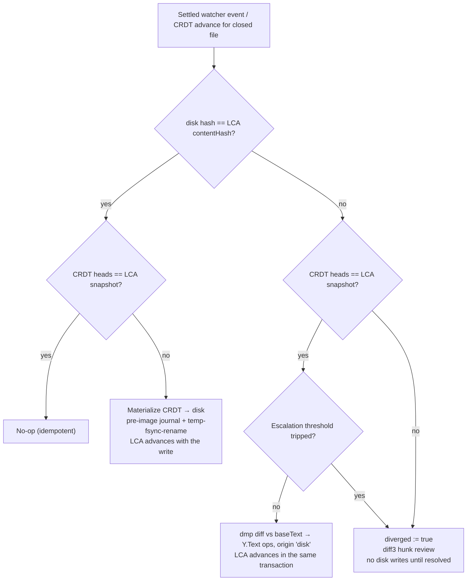

# Vault and reconciler — V1 dataflow

`libs/vault` is the bridge between the canonical world (plain `.md` files on disk, also
written by git, Claude Code, and Obsidian) and the CRDT world (always-on Y.Docs for
enrolled files, reached only through the `libs/sync` seam). This doc covers the watcher,
the reconciler's classification matrix, the LCA store, enrollment, escalation, and
recovery. Ground truth: shaping **D2, D2a, D2b, D2d, D2f** and the V1 non-UI affordances
in [plans/slices.md](../../plans/slices.md). Background reading: the
[LCA reconciliation primer](../primers/03-lca-reconciliation.md).

Design lineage note: the reconciler is our own design implementing the general
LCA/shadow-copy pattern (keep a durable record of the last state both sides agreed on;
classify changes by diffing each side against it). It is informed by published
post-mortems of the alternatives — overwrite-on-load anti-patterns, LCA-bump-without-
ingest data loss (shaping decision log) — not by any external implementation's source.

## Watcher

`TauriVaultAdapter` (Tauri's native `watchImmediate`) emits raw FS events, which are
useless as-is: editors write via temp+rename, git touches hundreds of files per branch
switch, and a single save can produce several events. The adapter layer normalizes:

- **Content-hash change detection.** An event only becomes a reconciler input if the
  file's content hash actually differs from the last known hash. Timestamp churn,
  metadata-only writes, and our own just-flushed writes (hash matches what we wrote)
  are dropped.
- **Quiesce = double-read-same-hash.** A changed file is read, hashed, and re-read
  after a short injected-clock delay; only when two consecutive reads hash identically
  is the content considered settled and handed to the reconciler. This is the defense
  against partial writes from non-atomic external writers.
- **Ignore list:** `.git/`, `.obsidian/`, `.editor/cache`.

## The reconciler: classification matrix

For each enrolled file the durable **LCA record** captures the last state where disk and
CRDT provably agreed. On every settled watcher event (and on every CRDT advance for a
closed file), the reconciler asks two independent questions: *did disk move since the
LCA?* (compare content hash) and *did the CRDT move since the LCA?* (compare heads
against the stored snapshot).

| Disk moved? | CRDT moved? | Classification | Action |
|---|---|---|---|
| no | no | In sync | No-op. Running the reconciler over a settled state must change nothing (idempotence — a blocking L1 invariant). |
| yes | no | **External-only** | diff-match-patch the LCA `baseText` → new disk text; apply the resulting span edits to the Y.Text as one transaction of CRDT ops tagged **origin `'disk'`**; advance the LCA in that same transaction. External edits become first-class ops other replicas merge normally. |
| no | yes | **CRDT-advanced** | Materialize the Y.Text to disk: restore the recorded EOL flavor/BOM, snapshot the current file into the pre-image journal, then write via atomic temp → fsync(temp) → rename; advance the LCA with the write. |
| yes | yes | **Diverged** (true three-way) | Set the `diverged` flag on the doc's `syncRecord`; surface diff3 hunks (base = LCA `baseText`) in the crude review UI with keep-mine / keep-theirs / accept-merge per hunk. **Never auto-write disk while unresolved.** CRDT sync continues; the disk file is simply not touched until a human resolves. |



Origin tags matter downstream: the editor binding ignores its own echoes, the sync layer
can distinguish disk-ingested ops in telemetry, and L1 fixtures assert that origin
`'disk'` transactions never loop back out as spurious disk writes.

## The LCA record and the iron rule

One record per enrolled file, in `lcaStore` — the **durable** app-data store
(an atomic JSON file per mount, `<room>/lca.json`; SQLite behind the same
interface if it is ever needed)
(shaping D5b): never the droppable index, never browser-evictable storage. Losing an LCA
record silently degrades every future merge of that file, so it is treated as
never-droppable state alongside the pre-image journal.

```
{ guid,          // stable doc identity (survives renames; path is just a binding)
  path,          // current path binding within the folder
  baseText,      // the agreed text at the LCA — the diff3/dmp base
  contentHash,   // hash of the exact bytes on disk at the LCA (post-EOL-restore)
  snapshot,      // CRDT heads at the LCA: state vector + delete-set digest (D1)
  eolFlavor,     // recorded at enrollment; text is normalized in-CRDT, restored on write
  bom }          // byte-order mark presence, same treatment
```

*(Assumption, consistent with D2/D5: `baseText` is stored directly for cheap diff3 even
though it is in principle re-derivable from the snapshot; slices lists the same record
with `stateVector+deleteDigest` spelled out — that pair is what `snapshot` means here.)*

**The iron rule: the LCA advances only in the same transaction as the CRDT ingestion or
materialization it describes.** Never on a timer, never on "looks equal", never as a
standalone bump. An LCA bump without a matching CRDT transaction *is* the data-loss bug
that killed the dormant-mode designs (shaping decision log, Offline/collab seam): once
disk == LCA with the CRDT left behind, the next reconcile classifies real offline work
as "only remote moved" and overwrites it.

## Enrollment

`enrollmentService` runs on first open of a shared folder (shaping D2b, slices wiring):

1. Walk the folder; for each text file, **mint a GUID** and record `path → guid` in the
   **folder Y.Doc** (the shared path map; advisory metadata, never an auth source).
2. **Seed once**: insert the file's content into a fresh Y.Text exactly one time, then
   write the initial LCA record in the same breath. A one-time-insertion guard makes
   re-running enrollment a no-op — content insertion must never repeat (MergeHSM-style
   invariant 1: no delete-all-and-reinsert, ever).
3. **Single-seeder rule for joiners** (V1): only the first device seeds. A device
   joining via share token pulls relay state into a clean or identical folder and
   inserts content only if the doc is verifiably empty. The full join/re-seed state
   machine (epoch fencing after relay restore, the git-clone-already-present case,
   tombstoned-GUID drains) is **Spike S1** — V1 simply forbids the ambiguous paths.
4. **Binary detection** → exclude from enrollment entirely + "not synced" badge in the
   tree (shaping D2f). V2 brings content-addressed blob sync; V1 just refuses to lie.

Create/rename/delete flow through the folder doc both directions: a local rename updates
the path binding (same GUID — content history survives renames); a remote map change
renames on disk through the same journaled, atomic write path.

## Escalation thresholds

Auto-ingest is for routine external edits. The reconciler escalates to review — same
`diverged` affordance, even when only one side moved — when a merge is *technically*
possible but *suspicious* (shaping D2, D2d):

- **Size/ratio threshold:** an external diff that rewrites too much of the file (large
  absolute churn or high changed-to-total ratio) is not silently merged.
- **Revert-of-recently-flushed:** an external write that reverts spans Editor recently
  flushed escalates instead of ingesting — the stale-editor-buffer signature (Obsidian's
  autosave echoing old content). A small ring of recently-flushed content hashes backs
  the check; its sufficiency against Obsidian's real autosave loop is **Spike S6**.
- **Mass-change circuit breaker:** many files changing within one quiesce window (a git
  branch switch, `git checkout .`) pauses reconciliation folder-wide and asks for
  confirmation rather than ingesting a storm of "external edits".

Thresholds are pure, clock-injected functions — unit-tested directly, with interleaving
explored by the L1 fuzzer ([testing.md](testing.md)).

## Recovery story

Two independent safety nets, because the reconciler is the highest-blast-radius code in
the system (shaping D2a; requirement R1.3):

- **Pre-image journal** (`preImageJournal`): before *every* Editor-initiated disk write,
  the file's current content is snapshotted into the durable store, with bounded
  retention. `editor restore <file> <t>` (CLI) restores any journaled pre-image —
  recovery from a reconciler bug must not depend on a git commit having happened.
- **Post-session git audit**: after any real-vault session, a `git diff --stat` audit
  script verifies only intended changes touched disk — no churn diffs, no EOL flips, no
  frontmatter reserialization (golden rule: never reserialize what you didn't change;
  byte fidelity is also a blocking L1 invariant).

V1 precondition (slices): no real-vault session until the test subfolder is committed
clean, the durable LCA store and pre-image journal exist, and the audit script is wired.

## See also

- [overview.md](overview.md) — where `libs/vault` sits; dependency rules (vault never
  imports editor, talks CRDT only through the seam).
- [sync.md](sync.md) — the other half: doc lifecycle, offline behavior, `syncRecord`.
- [testing.md](testing.md) — L1 reconciler fuzz, blocking invariants, `fuzz-crashers/`.
- Primers: [03-lca-reconciliation](../primers/03-lca-reconciliation.md),
  [02-plain-text-crdt-over-markdown](../primers/02-plain-text-crdt-over-markdown.md).
- Plans: [shaping.md](../../plans/shaping.md) D2/D2a–D2f, Spikes S1/S2/S3/S6;
  [slices.md](../../plans/slices.md) V1 non-UI affordances.
