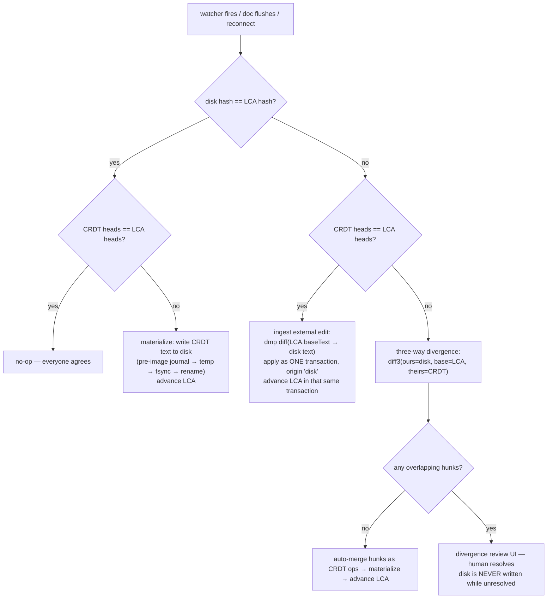

# Primer 03 — LCA reconciliation: files and CRDTs telling each other the truth

> Part of the [primer series](../README.md). Previous: [plain-text CRDT](02-plain-text-crdt-over-markdown.md). Next: [engine seam](04-engine-seam.md). Terms: [glossary](../glossary.md).
>
> **This is the core primer.** The reconciler is where the vault-corruption risk lives, where our nastiest design bug was found and killed, and where most of the test harness points.

## The two-truths problem

Editor's foundational rule: **files on disk are canonical** (R1). But for every [enrolled](../glossary.md#enrolled-file) file there is *also* a live `Y.Doc` whose `Y.Text` should hold the same content. Two stores, two writers' worlds:

- The CRDT moves when you type in Editor, or when a teammate's ops arrive from the relay.
- The disk moves when git checks out a branch, Claude Code rewrites a section, Obsidian autosaves, or `sed` runs.

Neither side can be ignored, and neither can blindly overwrite the other. The cautionary tale is jupyter-collaboration (issue #243, open since 2024): on an out-of-band file change it replaces the whole CRDT body — delete-everything, insert-the-new-file. Consequences documented by its own users: data loss correlated with external changes, and history bloat (~1.6 KB of CRDT growth per 1 KB changed) until new clients choke on the download. Wholesale replacement destroys the operational history that makes merging work.

## The pattern: a shadow copy as merge base

The fix is the classic move every serious file syncer makes (Dropbox-style syncers keep a last-synced snapshot; git merges through a merge base; relay.md proved the same shape works for an Obsidian vault over Yjs — see the `file-crdt-reconciliation` research note): **remember what both sides last agreed on**. We call that the **LCA** — last common ancestor — and keep one per enrolled file in `lcaStore`, a durable device-local store (an atomic JSON file in app-data — never the droppable index, never browser-evictable storage; more on why below):

```
{ guid, path, baseText, contentHash, eolFlavor, bom, heads (sv + ds digest), snapshot }
```

With a base in hand, every wake-up of the reconciler is a *classification*, not a guess. Hash the file, compare to the LCA; compare the doc's [heads](01-crdts-and-yjs.md#delete-sets--and-the-bug-class-heads--sv--ds-prevents) to the LCA's heads:



The four quadrants, in words:

| | CRDT unchanged | CRDT changed |
|---|---|---|
| **disk unchanged** | no-op | **materialize** CRDT → disk |
| **disk changed** | **ingest** disk → CRDT via diff | **three-way divergence** → diff3 + review |

**Ingest** uses diff-match-patch: compute a minimal character diff from `LCA.baseText` to the new disk text and apply it as ordinary insert/delete ops in a single transaction tagged with the `disk` [origin](01-crdts-and-yjs.md#transactions-and-origins). To every collaborator, a git pull or Claude Code edit just looks like another peer typing — it merges with their concurrent ops like anything else. (A diff *approximates* intent — a moved paragraph becomes delete+insert — which is acceptable for small edits and exactly why big ones escalate; see thresholds below.)

**Materialize** writes the CRDT text out — only when the editor doesn't own the file (invariant 3 below), always through the pre-image journal and an atomic temp-file → fsync → rename, restoring the file's recorded EOL flavor and BOM (content is normalized to LF *inside* the CRDT, so a CRLF vault stays CRLF on disk and never churns).

**Three-way divergence** is the honest case: both sides moved and the disk side's intent was never captured as ops, so no CRDT can merge it — this is moment.dev part 1's real lesson (merging long-diverged edits is a review problem, not an algorithms problem). We run textual `diff3(ours=disk, base=LCA.baseText, theirs=CRDT text)`: non-overlapping hunks auto-merge as CRDT ops; overlapping hunks open the **divergence review** affordance — hunk-level keep-mine / keep-theirs / accept-merge, in-editor. Never a `*.conflict` file, never git UX (R2/R3).

## A worked example

The LCA for `shopping.md` holds:

```markdown
# Shopping
- milk
- eggs
```

**Scenario 1 — ingest.** Editor is closed on this note; Claude Code appends `- bread`. Watcher fires, quiesce passes. Disk hash ≠ LCA hash; CRDT heads == LCA heads (nobody else touched it). Classification: external-only. dmp diffs base→disk, yielding one op — insert `"- bread\n"` at offset 25 — applied in a single `'disk'`-origin transaction; the LCA's text, hash, and heads advance inside that same transaction. A teammate watching the doc live sees `- bread` appear as if typed.

**Scenario 2 — clean three-way.** Same external edit, but meanwhile a teammate renamed the heading to `# Groceries` via the relay, so CRDT heads ≠ LCA heads too. Classification: divergence. diff3 against the base finds two hunks — heading line (theirs) and appended line (ours) — that don't overlap. Both auto-merge: the disk hunk becomes CRDT ops, the merged text materializes to disk, LCA advances. No human involved.

**Scenario 3 — review.** Claude Code rewrote `- eggs` to `- eggs (free range)` while the teammate concurrently changed the same line to `- eggs x12`. Overlapping hunk: the file's `diverged` flag flips, the [sync pill](05-sync-and-relay.md#sync-state-that-never-lies) goes red, and the review affordance shows the hunk with both candidates. Disk is not written until a human picks; everything *else* in the file that merged cleanly already has.

## The iron rule, and the bug that forged it

> **The LCA advances only inside the same transaction that brings the CRDT to the matching state.**

Equivalently: an LCA must never *claim* agreement that wasn't actually established as CRDT operations. This sounds pedantic until you watch it kill the design it killed.

Shapes A and C in `shaping` proposed a tempting optimization called **dormancy**: when no collab session is live, skip the CRDT entirely — write the file, "bump" the LCA to match the new disk content, and load the Y.Doc lazily later. Cheaper, simpler, and the adversarial distsys review proved it is a *specified data-loss algorithm*:

```mermaid
sequenceDiagram
    participant D as Disk (laptop)
    participant L as LCA record
    participant C as CRDT (loaded lazily)
    participant R as Relay (teammate edits)
    Note over D,C: dormant mode — no Y.Doc in memory
    D->>D: offline: you write three paragraphs
    D->>L: "LCA bump": LCA := new disk content ☠
    Note over L: LCA now matches disk —<br/>but no CRDT ops were ever created
    R->>R: meanwhile a teammate edits the same note
    Note over D,R: reconnect; Y.Doc loads, pulls remote state
    C->>C: classify: disk == LCA → "only the CRDT moved"
    C->>D: materialize remote → disk (top-right quadrant)
    Note over D: your three paragraphs are gone.<br/>No divergence detected, no review — by design.
```

The bump forged `disk == LCA`, which the classifier *correctly* reads as "the disk has nothing new" — collapsing a true bottom-right (divergence, review!) into a top-right (clean materialize). The machinery worked perfectly and lost the data anyway, because its memory was falsified. This is recorded in the Decision log ("Offline/collab seam" row, two fatal verdicts) and is why golden rule 3 in [CLAUDE.md](../../CLAUDE.md) says **there is no dormant mode**: enrolled files run an always-on local Y.Doc, so offline edits are real ops from the moment they happen, and the LCA only ever advances hand-in-hand with the doc. (Tracked — never-shared — files have *no* CRDT and no LCA at all; the dichotomy is enrolled-and-always-on or nothing.)

The same logic dictates *where* the LCA lives: in durable app-data storage. An LCA in browser-evictable storage (OPFS/IndexedDB) can vanish, and a lost merge base degrades every future classification into a guess.

## Invariants the reconciler must never break

These are the distilled rules of the file↔CRDT pattern — the ones relay.md's production state machine (their "MergeHSM") proved viable, the same ones our `reconciler` enforces and our fuzz harness asserts:

1. **One-time insertion.** A file's content enters its CRDT exactly once, at enrollment. Afterwards content moves only as ops (ingest diffs included). Re-inserting on join is how you get the entire document duplicated — hence the single-seeder rule for second devices (Spike S1).
2. **Never delete-all + reinsert.** The jupyter-collaboration failure. Always diff.
3. **The editor owns the open file.** While a doc is open in Editor, the reconciler does not write that path; CRDT→disk flushes happen on a debounced idle/close policy. (External *reads* of a slightly-stale file are fine; two writers on one path are not.)

## Escalation: when *not* to auto-merge

Auto-ingest is for edits that look like edits. Three tripwires route to review or pause instead (D2/D2d in shaping):

- **Size/ratio threshold.** A diff that replaces most of the file (`git checkout` of an old branch, a generator rewriting a doc) isn't an "edit", and dmp's character diff will mangle its intent. Above the threshold: treat as divergence, show review.
- **Revert-of-recently-flushed-spans.** If an external write *undoes* spans Editor flushed moments ago, it's likely a stale editor buffer (Obsidian autosaving an old copy) — auto-ingesting it would revert teammates' edits. A ring of recently-flushed content hashes detects the echo; such writes always escalate (Spike S6 hardens this against Obsidian's real autosave behavior).
- **Mass-change circuit breaker.** The watcher seeing *many* files change near-simultaneously means a vault-level event — a git branch switch, a restore, a bulk script. Per-file auto-merge across hundreds of files is how a tool shreds a vault in one second. The breaker pauses reconciliation and asks one question ("branch switch detected — re-sync N files?") before proceeding.

Underneath all of it, the watcher trusts only **content hashes** (never mtime alone), and treats a file as settled only after **quiesce** — two reads yielding the same hash — so partial writes and save-storms never get classified mid-flight. The same rule holds for a file that is new: one another writer creates while the app runs is enrolled only once it has held still, so a half-written file is never seeded into its CRDT (and synced) as if it were whole.

## The safety net under the safety net

Classification bugs are assumed, not hoped away (R1.3). Every Editor-initiated disk write is preceded by a **pre-image journal** entry — a bounded-retention snapshot of the file's prior content with `editor restore <file> <t>` to roll back — and followed in dogfood sessions by a `git diff --stat` audit. The L1 fuzz harness drives this whole machine over memfs with crash injection, and every counterexample it ever finds becomes a permanent fixture in `fuzz-crashers/`.

## Further reading

- the `file-crdt-reconciliation` research note — prior art survey, jupyter counter-example
- `shaping` D2/D2a/D2d + Decision log rows "Offline/collab seam", "Reconciliation"
- `slices` V1 — `reconciler`, `lcaStore`, `preImageJournal` affordances
- Next primer: [the engine seam](04-engine-seam.md)
