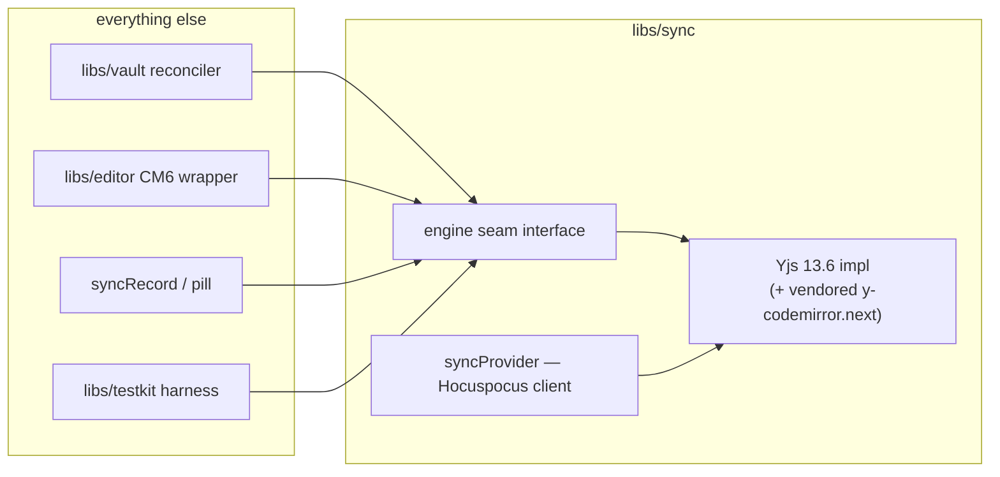

# Primer 04 — The engine seam

> Part of the [primer series](../README.md). Previous: [LCA reconciliation](03-lca-reconciliation.md). Next: [sync and the relay](05-sync-and-relay.md). Terms: [glossary](../glossary.md).

## What "engine seam" means

A *seam* is a place where you can change a system's behavior without editing the code on the other side of it. The **engine seam** is a deliberately thin TypeScript interface in `libs/sync` that everything else in the monorepo programs against, with Yjs as the *current implementation behind it*. The reconciler diffs text into "a doc"; the editor binds to "a text"; the sync record compares "heads" — none of them know those are `Y.Doc`, `Y.Text`, and `{sv, ds}`.

The enforcement rule is blunt and lintable:

> **Nothing outside `libs/sync` imports `yjs`.** No `Y.Doc` in component props, no `Uint8Array`-shaped Yjs updates in app code without an opaque wrapper type, no `instanceof Y.Text` anywhere else. If a feature seems to need a Yjs API, the seam grows a method — the import does not leak.

## Why we pay for this

Seams aren't free — every abstraction layer is code, indirection, and the risk of designing for engines we never use. We bought this one for three specific, dated reasons (Decision log, "CRDT engine" row in `shaping`):

1. **The Yjs v14 migration is already on the calendar.** We pinned v13.6.x while v14 sits in RC (it brings AttributionManagers — the history/diff surface agents will want). When v14 goes GA, the migration is gated behind *the seam plus a full harness pass*: swap the implementation, run the same invariant suite, ship. Without the seam, v14 is a repo-wide find-and-fix.
2. **Loro is a real hedge, not a slogan.** The `crdt-engine` research note found Loro technically strongest (Fugue merge semantics, native history/time-travel) but ecosystem-thin. Its trigger is recorded in `slices` (Later): conflict-range marking ships, or Yjs maintenance falters. The swap is plausible *only because* both engines bind plain text — the seam's surface is the part they share.
3. **Tests against invariants, not internals.** The harness asserts *convergence on encoded state*, *no disk corruption*, *offline rejoin* — properties any engine must satisfy — rather than Yjs struct-store details. That makes the harness the engine's acceptance test: if a swap passes, we trust it; if the harness only understood Yjs internals, a swap would mean rewriting the safety net at the exact moment we need it most.

There's a quieter fourth reason: the seam keeps *us* honest. The [delete-set lesson](01-crdts-and-yjs.md#delete-sets--and-the-bug-class-heads--sv--ds-prevents) became a seam-level concept — `heads` is defined by our interface as "state vector + delete-set digest", so no caller can accidentally reach for the cheaper, wrong `encodeStateVector` alone.

## What belongs in the seam

A sketch of the shape (illustrative, not the literal signatures — those live in `libs/sync` and may drift; this won't be kept in lockstep):

```ts
interface SyncEngine {
  openDoc(guid: DocGuid): SyncDoc
}
interface SyncDoc {
  readonly text: SyncText                      // the file's contents
  heads(): Heads                               // ALWAYS sv + delete-set digest
  encodeUpdate(since?: Heads): OpaqueUpdate    // bytes for the wire / persistence
  applyUpdate(u: OpaqueUpdate): void
  transact(fn: () => void, origin: EditOrigin): void
  onChange(cb: (delta: TextDelta, origin: EditOrigin) => void): Unsubscribe
}
type EditOrigin = 'editor' | 'disk' | 'remote' | 'reconciler'
```

The surface is "what the rest of Editor actually consumes", nothing speculative:

| Concern | Shape (illustrative) | Used by |
|---|---|---|
| Doc lifecycle | `openDoc(guid)`, `closeDoc`, doc handles are opaque | enrollment, docSession |
| Text ops | `getText()`, `insert(i, s)`, `delete(i, n)`, `applyDiff(patches)` in one txn | reconciler ingest, editor |
| Updates | `encodeUpdate(doc, sinceHeads?)`, `applyUpdate(doc, bytes)` — bytes opaque | provider wiring, persistence |
| Heads | `heads(doc)`, `headsEqual(a, b)` — **always sv + ds digest** | LCA records, sync record, harness |
| Snapshots | `snapshot(doc)` / restore-for-comparison | lcaStore |
| Observation | `onChange(doc, (delta, origin) => …)` | materialization, index, pill |
| Origins/transactions | `transact(doc, fn, origin)` with our origin enum (`'editor' \| 'disk' \| 'remote' \| …`) | everyone (echo suppression) |
| Awareness | thin presence pub/sub | cursors, future agent presence |

Mermaid view of who sits where:



## What deliberately stays out

- **Provider/transport.** Connecting, reconnect/backoff, auth tokens, the relay protocol — that's the `syncProvider`'s job ([primer 05](05-sync-and-relay.md)). It lives in `libs/sync` *next to* the engine code (it's necessarily engine-coupled — it ships engine updates over the wire), but the seam interface doesn't model sockets. Swapping the engine and swapping the transport are different decisions with different triggers; one interface trying to abstract both would do neither well.
- **Persistence.** y-indexeddb today (with a hard exit trigger before teammate onboarding), a durable doc store later — storage choices ride D5's storage interface, not the engine seam. The seam hands out opaque update bytes; where they rest is someone else's policy.
- **Reconciliation policy.** The classification matrix, thresholds, and the LCA rule are *Editor's* logic in `libs/vault`. The seam gives it primitives (diff-as-transaction, heads); it must never grow opinions about when to use them.
- **Anything Yjs-shaped without a second customer.** Subdocuments, relative positions as a public currency, GC tuning — implementation details until a real consumer forces a seam method.

## The acknowledged seam-crossing: the editor binding

A CM6 collab binding is engine-specific by nature — it translates editor changes into engine ops and back. We use a **vendored** copy of `y-codemirror.next` (vendored because upstream's stable release is slow-moving and we'd rather own a frozen small thing than depend on a dormant one — same treatment as diff-match-patch and node-diff3). It lives with the engine code inside `libs/sync`'s implementation side and is exposed to `libs/editor` as "the binding", so an engine swap replaces implementation + binding together (`loro-codemirror` is the drop-in counterpart). That containment is the point: one known crossing, in one package, swapped as one unit — not a repo-wide weave.

## How you'll feel the seam day-to-day

- Building UI or vault features: you'll touch `SyncDoc`/`SyncText`-style types from `libs/sync` and never see a `Y.` prefix. If you find yourself wanting one, that's a seam-design conversation, not an import.
- Writing tests: `libs/testkit`'s TestNetwork drives seam-level docs with seeded randomness; your properties should be statable without naming Yjs.
- Reviewing: a `from 'yjs'` outside `libs/sync` is an automatic flag (lint will catch it; humans should too).

## Further reading

- the `crdt-engine` research note — the engines, the hedge, what choosing Yjs forecloses
- `shaping` D1 — the seam's charter
- the `collab-testing` research note — invariant-first harness design
- Next primer: [sync and the relay, end to end](05-sync-and-relay.md)
