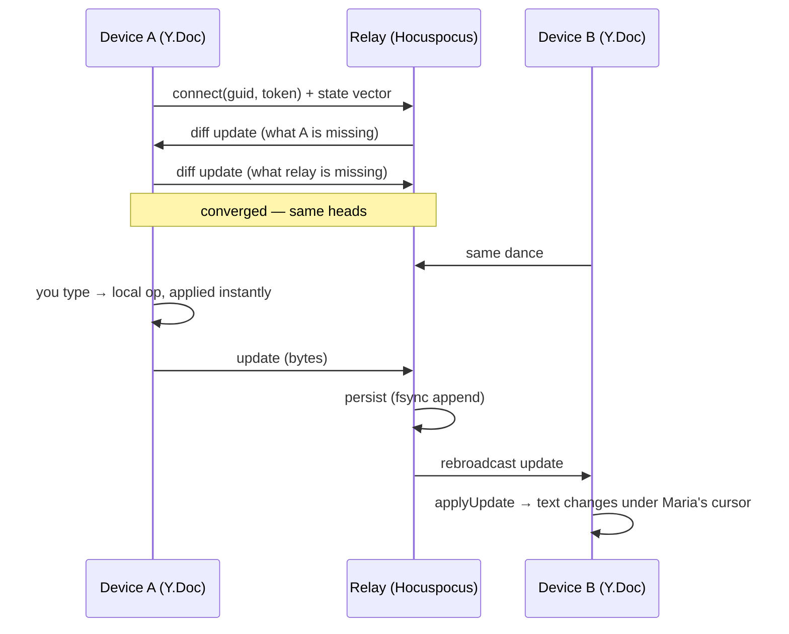

# Primer 05 — Sync and the relay, end to end

> Part of the [primer series](../README.md). Previous: [engine seam](04-engine-seam.md). Terms: [glossary](../glossary.md).

## The cast

- **Local Y.Doc** — one per [enrolled](../glossary.md#enrolled-file) file, always on, persisted locally (y-indexeddb in V1). This is the working copy your editor binds to. It exists and works whether or not any network does.
- **Provider** (`syncProvider`, in `libs/sync`) — the client-side plumbing that connects a local doc to the relay over WebSocket, speaks the sync protocol, and reconnects with backoff.
- **Relay** (`apps/relay`) — a thin [Hocuspocus](../glossary.md#hocuspocus) v4 service on Fly.io with SQLite persistence (continuously replicated off-box via litestream). It authenticates connections, persists doc state, and rebroadcasts updates to whoever else holds the doc open.
- **Folder doc** — one extra Y.Doc per shared folder: a CRDT map of vault-relative paths → file GUIDs (+ metadata). It's how renames, creates, and deletes propagate, and how the file tree renders.

## The happy path



Two properties to internalize:

1. **Local first, literally.** Your keystroke commits to the local doc before any network is involved. The relay is *behind* your editing experience, never in front of it — this is what makes R4.1 ("no remote round-trip ever gates reading or editing") structural rather than aspirational, and it's the exact opposite of HackMD's architecture.
2. **The relay is a rendezvous, not an authority.** It stores opaque update bytes and forwards them; it never interprets, merges, or rewrites content — [CRDT math](01-crdts-and-yjs.md) makes every peer's merge identical without a referee. We treat it as *untrusted-ish*: losing it loses availability of the meeting point, not data (every device holds full state), and the design keeps document payloads opaque to the server so an E2EE mode (Keyhive watch-track, R8) could slot in later. The honest exceptions to "untrusted": it enforces *access* (shares table), and its persistence is what a green pill vouches for — see below.

## Offline needs no machinery — and why the alternatives died

When the relay is unreachable, nothing changes mode. The provider is disconnected; you keep editing the always-on local doc; ops accumulate locally. On reconnect, the provider runs the same state-vector exchange as any fresh connection — "here's what I've seen, give me the rest, here's your missing piece" — and everyone converges:

```mermaid
sequenceDiagram
    participant A as Laptop (on a plane)
    participant R as Relay
    participant B as Teammate
    Note over A,R: connection drops — pill goes offline, honestly
    A->>A: keeps editing the local doc (ops pile up, pendingOps > 0)
    B->>R: keeps editing too — relay persists + holds her ops
    Note over A,R: wifi returns — provider reconnects
    A->>R: state vector (what A has seen)
    R->>A: diff: B's ops from the gap
    A->>R: diff: A's plane ops
    R->>R: fsync append → durable ack
    R->>B: rebroadcast A's ops
    Note over A,B: identical merged text on both sides; pill green
```

Offline → online is *the sync protocol's normal case*, not a transition between architectures. Kill the relay mid-session and both sides keep typing; restore it and they converge: that's literally the V1 demo script in `slices`.

This "boring offline" is a survivor of adversarial review, and the original framing it replaced is worth remembering (Decision log, "Offline/collab seam"):

- The **dormant** design (shapes A/C): no live session → no Y.Doc, just file writes + an LCA bump. Proven to be a specified data-loss algorithm — the full autopsy is in [primer 03](03-lca-reconciliation.md#the-iron-rule-and-the-bug-that-forged-it).
- The **session-scoped** design (shape B): engage collab machinery only when two people open the same note. Its predicate ("is anyone else editing?") is *undecidable while offline*, gets crossed on every network blip, and turns live collab into lossy textual merges at each boundary.

Both flowed from a misreading of moment.dev part 1 — "a lone offline user needs less machinery." The `moment-dev-lies` research note re-read the article: its actual claim is that *automatically merging long-diverged edits* produces results users read as corruption, so divergence needs review UX. The danger axis is not solo-vs-collab; it's **divergence from ANY writer** — and this vault diverges constantly even with one human, via git pulls, Claude Code sessions, and Obsidian. So machinery is always on (cheap, local, no relay needed), and the *review affordance* engages on significant divergence, whoever caused it (R3). Convergence is the CRDT's job; acceptability is the review UI's.

## Sync state that never lies

Syncthing's deepest failure wasn't lost edits — it was that you *couldn't tell*. Requirement R2.3: "is it safe to edit here?" must be answerable, and green must never lie.

Mechanism (D11): each open doc has a reactive **sync record** — `{connected, pendingOps, diskMatchesCrdt, diverged, durableAck}` — and the **sync pill** is a *pure function* of that record. Pure means: no timers, no vibes, no "probably fine" — the same record always renders the same pill, which makes pill correctness a unit-testable property the harness asserts *under network partition*. Roughly:

| Situation | Record | Pill |
|---|---|---|
| Everything settled: connected, nothing pending, disk written, relay fsynced | `{✓, 0, ✓, –, ✓}` | green |
| Your last edits sent but not yet durably acked (or still being flushed to disk) | `{✓, >0 or disk pending, –, –}` | yellow |
| True divergence awaiting [review](03-lca-reconciliation.md) | `{–, –, –, diverged}` | red |
| Relay unreachable — editing fine, sharing paused | `{✗, …}` | offline |

The strictest clause: **green requires durable ack**. A plain Yjs websocket provider says "synced" when the server *received* your update — but a relay that crashes after receipt and before persisting would make that green retroactively false. Our green means the relay has **fsynced** your ops to its log (D4a; the per-update ack mechanism is Spike S4, since the stock y-protocol has no per-update acks). Until then you get honest yellow: pending. The pill also folds in the disk dimension (`diskMatchesCrdt`, from the [reconciler](03-lca-reconciliation.md)) and `diverged` (review pending) — because "synced with the relay but not yet written to the file git sees" is a state worth telling the truth about. Binaries are excluded and badged "not synced" rather than ever being claimed (R1.2). Later: per-device acked heads give "your phone last caught up at T".

## Sharing: per-note and per-folder

The unit of sharing is a note or a directory (R2) — never all-or-nothing like Syncthing.

- **Naming.** Docs live under GUID names: `<folderGuid>/<docGuid>`. GUIDs are minted at enrollment and bound to paths by the folder doc's path-map. Paths rename; GUIDs don't — so a rename is a map edit, not a new document, and edit history survives reorganization.
- **Authorization is relay-authoritative.** Who may open which folder/doc lives in a relay-side **shares table**, mutated only via authenticated CLI/API. The folder doc's path-map is *advisory* — UI and binding information, never an auth source. This kills a real attack found in shaping (shape C let any client *write* itself a grant by editing a synced CRDT map: privilege escalation by keystroke). Rule of thumb: **a CRDT any client can write must never be a security boundary.**
- **Tokens.** V1: a static bearer token per share (`editor share` hands it out; relay checks it in `onAuthenticate`). Team onboarding upgrades to Ed25519 device-key principals — a user is a *group of device keys*, which is both better ops hygiene and Keyhive-compatible if the E2EE track ever lands. Revoking a share closes its live connections immediately.
- **Per-note shares** get a minimal metadata side-channel (the note's name only) rather than the whole folder map — sharing one note must not leak your folder structure.
- **Joining** follows the single-seeder rule: the first device enrolls (one-time content insertion); a joiner pulls relay state instead of inserting, and only seeds content if the doc is verifiably empty. Two devices both "helpfully" inserting the same file is the classic duplicated-document failure ([primer 03](03-lca-reconciliation.md), invariant 1; the full join/re-seed state machine is Spike S1).

## What the relay runs

Hocuspocus v4 was chosen as the *thin* option (Decision log, "Sync server"): a maintained Node server speaking the standard y-protocol with hooks for auth and persistence — we add a shares table, SQLite persistence on a Fly volume, litestream replication, and (V2) an append-only update log with snapshot+truncate compaction that doubles as agent-facing history ("what changed since X?"). Alternatives and their disqualifiers — y-sweet (upstream stalled; the maintained fork is our tested plan B), yhub (AGPL + ops-heavy), partykit (platform lock-in) — are in the `sync-server` research note. Self-hosting on a cheap VPS/Fly.io is R2.1: no third-party control plane, which is precisely the part relay.md kept proprietary and we therefore keep tiny and our own.

## Further reading

- the `sync-state-ux` research note — pill prior art (Linear, Figma, relay.md) and the data-layer checklist
- the `moment-dev-lies` research note — the divergence-from-any-writer reframing
- `shaping` D4, D4a, D11 + Spikes S1/S4/S5
- Back to: [LCA reconciliation](03-lca-reconciliation.md) for the disk half of the story
